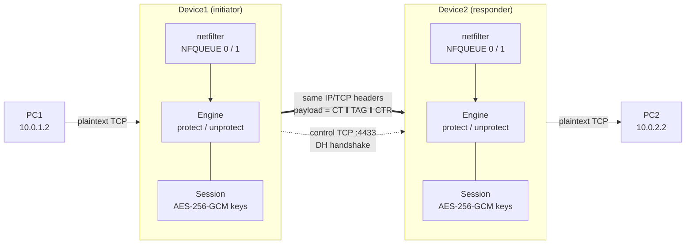
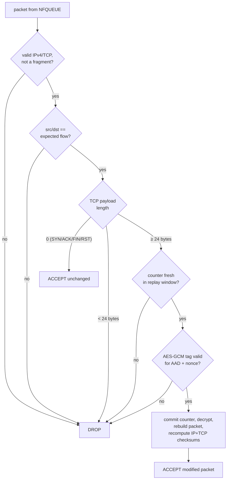

<div align="center">

# 🔐 scgw — Secure Inline TCP Payload Channel

**Transparent AES-256-GCM protection of TCP payloads between two Linux gateways,<br>
keyed by a Diffie–Hellman handshake, with no tunnel, no UDP encapsulation and no custom header.**


`PC1  ──►  Device1  ═══ protected TCP packets ═══►  Device2  ──►  PC2`

</div>

---

## Table of contents

1. [Problem statement and requirements](#1-problem-statement-and-requirements)
2. [Requirement traceability matrix](#2-requirement-traceability-matrix)
3. [Architecture](#3-architecture)
4. [Handshake: authenticated Diffie–Hellman](#4-handshake-authenticated-diffiehellman)
5. [Key schedule](#5-key-schedule)
6. [Data plane: the packet transformation](#6-data-plane-the-packet-transformation)
7. [Nonce uniqueness: argument and enforcement](#7-nonce-uniqueness-argument-and-enforcement)
8. [Receiver pipeline and drop policy](#8-receiver-pipeline-and-drop-policy)
9. [Kernel integration (netfilter)](#9-kernel-integration-netfilter)
10. [Rekeying, liveness and failure behaviour](#10-rekeying-liveness-and-failure-behaviour)
11. [Threat model and security analysis](#11-threat-model-and-security-analysis)
12. [Design decisions and rejected alternatives](#12-design-decisions-and-rejected-alternatives)
13. [Repository layout](#13-repository-layout)
14. [Installation and usage](#14-installation-and-usage)
15. [CLI reference](#15-cli-reference)
16. [Verification and test evidence](#16-verification-and-test-evidence)
17. [Limitations and honest caveats](#17-limitations-and-honest-caveats)
18. [Future work](#18-future-work)
19. [References](#19-references)

---

## 1. Problem statement and requirements

Two hosts, **PC1** and **PC2**, communicate through two inline devices:

```
PC1 → Device1 → Device2 → PC2
```

The devices must process *selected* TCP/IPv4 traffic and establish a secure session **before** any protected data is sent. The project implements the following specification:

| # | Requirement |
|---|-------------|
| R1 | Linux-based prototype; the devices process selected TCP/IPv4 traffic inline. |
| R2 | A secure session is established before protected transmission begins. |
| R3 | **Diffie–Hellman** key exchange during the handshake yields a shared session key between Device1 and Device2. |
| R4 | For each protected TCP packet, encrypt **only the TCP payload** with **AES-GCM**. |
| R5 | **Preserve** the original IP and TCP headers. |
| R6 | **Append the AES-GCM authentication tag** to the encrypted payload. |
| R7 | Forward the modified packet **directly** to the peer device — **no UDP encapsulation, no custom protocol header**. |
| R8 | The receiver **verifies the tag**, **decrypts**, **restores the original packet structure**, **recalculates IP and TCP checksums**, and forwards to the destination. |
| R9 | A **unique AES-GCM nonce** is used for **every** encrypted packet within a session. |

---

## 2. Requirement traceability matrix

Every requirement maps to concrete code and to at least one automated test.

| Req | Where it is implemented | Where it is verified |
|-----|--------------------------|----------------------|
| R1 | `scripts/setup_iptables.sh` (selection by IP/port), `src/scgw/nfq.py` (NFQUEUE), `src/scgw/packet.py` (IPv4/TCP parsing) | `test_packet.py` (4 tests), `test_wrong_flow_and_fragments_dropped` |
| R2 | `control.py` (`Initiator`/`Responder`), `engine.py` (`protect()` drops data when no session exists) | `test_fail_closed_without_session`, `demo/netns_demo.sh` step 1 |
| R3 | `crypto.py` (`DHKeyPair`, RFC 3526 group 14), `handshake.py`, `derive_keys()` | `test_dh_group_is_2048bit_safe_prime`, `test_dh_agreement_and_validation`, `test_both_sides_derive_matching_directional_keys` |
| R4 | `crypto.py` (`TxState.seal` → `AESGCM.encrypt`), `engine.py` (`protect`) | `test_roundtrip_restores_original_exactly` (asserts plaintext is *not* in the wire payload) |
| R5 | `packet.assemble()` only rewrites IP total-length, IP checksum, TCP checksum | `test_roundtrip_…` (compares address/port/seq/ack/flag bytes), `test_tcp_options_preserved` |
| R6 | `TxState.seal` returns `ciphertext ‖ tag(16) ‖ counter(8)` | `test_seal_open_and_layout` (`len == len(P)+24`), `test_roundtrip_…` |
| R7 | `engine.protect` returns the *same packet* with a longer payload; kernel forwards it by normal routing | `test_roundtrip_…` (headers identical, IP protocol still 6) |
| R8 | `engine.unprotect`, `RxState.open`, `packet.assemble`, `packet.checksums_ok` | `test_roundtrip_…` (byte-identical restoration + valid checksums), `test_tampering_any_payload_byte_is_dropped` |
| R9 | `TxState` (lock-protected monotonic counter), per-direction keys, `ReplayWindow` | `test_nonce_counter_never_repeats_and_is_sequential`, `test_nonce_unique_across_threads`, `test_unique_nonce_for_every_packet_including_retransmissions`, `test_exhaustion_fails_closed` |

---

## 3. Architecture

### 3.1 Two planes

| Plane | Transport | Carries |
|-------|-----------|---------|
| **Control plane** | An ordinary TCP connection **Device1 → Device2** (default port 4433). It terminates *on the devices themselves* (netfilter INPUT/OUTPUT), so it is never forwarded or modified. | DH handshake, key confirmation, liveness, rekeying |
| **Data plane** | The *original* PC1↔PC2 TCP packets, modified in place as they transit the devices. | Encrypted TCP payloads |

### 3.2 End-to-end flow



### 3.3 Symmetric roles

Each device runs the same engine in **both** directions:

| Device | Queue 0 – *protect* (encrypt) | Queue 1 – *unprotect* (decrypt) |
|--------|------------------------------|---------------------------------|
| Device1 | ingress on LAN-if, `PC1 → PC2` | ingress on WAN-if, `PC2 → PC1` |
| Device2 | ingress on LAN-if, `PC2 → PC1` | ingress on WAN-if, `PC1 → PC2` |

The `initiator`/`responder` role only decides *who opens the control connection*; both devices encrypt and decrypt.

---

## 4. Handshake: authenticated Diffie–Hellman

A secure session exists **before** the first protected data packet (R2): until the handshake finishes, the engine has no session, and `protect()` **drops** data segments rather than sending them in clear.

```mermaid
sequenceDiagram
    autonumber
    participant I as Device1 (initiator)
    participant R as Device2 (responder)
    Note over I: x ← random(320 bit)<br/>X = 2^x mod p<br/>N_i ← random(256 bit)
    I->>R: ClientHello: ver ‖ N_i ‖ X  + HMAC_PSK("CH", CH)
    Note over R: verify MAC<br/>validate X (range + subgroup)<br/>y ← random; Y = 2^y mod p; N_r ← random
    R->>I: ServerHello: ver ‖ N_r ‖ Y  + HMAC_PSK("SH", CH, SH)
    Note over I: verify MAC; validate Y
    Note over I,R: K = Y^x = X^y mod p<br/>TH = SHA-256(CH ‖ SH)<br/>keys = HKDF(K, salt = H(N_i‖N_r), info = "scgw/v1/keys" ‖ TH)
    I->>R: Finished_I = HMAC(k_confirm, "I" ‖ TH)
    Note over R: verify → install session
    R->>I: Finished_R = HMAC(k_confirm, "R" ‖ TH)
    Note over I: verify → install session → data may flow
```

**Properties**

| Aspect | Choice | Rationale |
|--------|--------|-----------|
| Group | RFC 3526 group 14 — 2048-bit MODP safe prime, *g* = 2 | Standardised group (~112-bit security). The code verifies in the test-suite that *p* is 2048 bits, that *p* and *q = (p−1)/2* are probable primes, and (offline) that *p* equals the RFC formula `2²⁰⁴⁸ − 2¹⁹⁸⁴ − 1 + 2⁶⁴·(⌊2¹⁹¹⁸·π⌋ + 124476)`. |
| Private exponent | 320 random bits (`secrets`) | ≥ 2× the security level (RFC 7919 guidance). |
| Public-value validation | Reject `y ∉ [2, p−2]` and `y^q mod p ≠ 1` | Blocks the small-subgroup / degenerate-value attacks (0, 1, *p*−1, non-residues). |
| Ephemeral keys | New DH pair on **every** handshake | **Forward secrecy**: later compromise of the PSK cannot decrypt recorded sessions. |
| Authentication | HMAC-SHA-256 over the hello messages with a pre-shared key | Raw DH is unauthenticated and therefore trivially MITM-able; the PSK closes that hole. `--no-auth` exists but prints a warning. |
| Key confirmation | `Finished` messages keyed with a value derived from the DH secret and bound to the **transcript hash** | Both sides prove they derived the same keys; downgrade/tamper of any hello field changes `TH` and fails. |
| Fresh nonces | `N_i`, `N_r` (32 B each) feed the HKDF salt | Even a repeated DH value would still yield distinct session keys. |

---

## 5. Key schedule

```
okm (104 bytes) = HKDF-SHA256( IKM  = K (256-byte DH shared secret),
                               salt = SHA-256(N_i ‖ N_r),
                               info = "scgw/v1/keys" ‖ TH )

  bytes   0 – 31   key_i2r      AES-256 key, Device1 → Device2 direction
  bytes  32 – 63   key_r2i      AES-256 key, Device2 → Device1 direction
  bytes  64 – 67   fixed_i2r    4-byte nonce prefix, initiator → responder
  bytes  68 – 71   fixed_r2i    4-byte nonce prefix, responder → initiator
  bytes  72 – 103  k_confirm    key for the Finished messages
```

**Why one key per direction?** Both devices start their packet counters at 0. With a single shared key, Device1's packet #0 and Device2's packet #0 would produce the *same* nonce under the *same* key — a catastrophic GCM failure. Separate keys (plus separate nonce prefixes as defence in depth) make that impossible by construction.

---

## 6. Data plane: the packet transformation

### 6.1 Byte-level layout

```
ORIGINAL PACKET (as sent by PC1)
 ┌──────────────────┬──────────────────────────┬───────────────────────────┐
 │ IP header (≥20 B)│ TCP header (≥20 B + opts)│ plaintext payload  P      │
 └──────────────────┴──────────────────────────┴───────────────────────────┘

PROTECTED PACKET (between Device1 and Device2)
 ┌──────────────────┬──────────────────────────┬──────────────┬─────────┬─────────┐
 │ IP header        │ TCP header               │ ciphertext   │ GCM tag │ counter │
 │ (unchanged*)     │ (unchanged*)             │ |CT| = |P|   │  16 B   │  8 B    │
 └──────────────────┴──────────────────────────┴──────────────┴─────────┴─────────┘
                                                └───── AES-GCM output ──┘
 * unchanged except: IP total-length, IP header checksum, TCP checksum (recomputed)
```

| Field | Bytes | Meaning |
|-------|-------|---------|
| `ciphertext` | `len(P)` | AES-256-GCM encryption of the original TCP payload. GCM is length-preserving. |
| `tag` | 16 | GCM authentication tag, **appended directly after the ciphertext** (R6). |
| `counter` | 8 | Big-endian explicit nonce counter (see §6.3). |
| **Overhead** | **24** | Added to every data-carrying segment. |

### 6.2 What is encrypted, what is authenticated

```
key    = key_dir                                   (per session, per direction)
nonce  = fixed_dir (4 B)  ‖  counter (8 B, big endian)          → 96 bits
AAD    = "SCGW1" ‖ src_ip ‖ dst_ip ‖ src_port ‖ dst_port ‖ tcp_seq
CT‖TAG = AES-256-GCM-Encrypt(key, nonce, plaintext = P, aad = AAD)
```

* Only the **payload** is encrypted (R4); IP and TCP headers stay readable and routable (R5).
* The **AAD** cryptographically binds each ciphertext to its flow (addresses + ports) and its **position in the TCP stream** (sequence number). A captured payload cannot be re-attached to a different connection or a different sequence number — the test `test_splice_into_other_flow_or_seq_dropped` forges exactly that and the packet is rejected.
* Segments with **no payload** (SYN, pure ACK, FIN, RST) contain nothing to protect and pass through unchanged; this keeps the TCP handshake and acknowledgements untouched.

### 6.3 Why an explicit counter at the end of the payload?

The receiver must know the nonce to decrypt. Without a custom header, there are only three places it could come from:

| Option | Verdict |
|--------|---------|
| **Derive it from TCP seq / IP-ID** | ❌ Not unique. TCP *retransmits* with the *same* sequence number, and Linux frequently sets IP-ID = 0 on DF packets. Two different ciphertexts under the same key and nonce break GCM confidentiality *and* integrity (key-stream reuse, GHASH key recovery). Violates R9. |
| **Implicit lock-step counter** (both sides count packets) | ❌ Fails on packet loss, reordering and duplication — all normal on IP networks. |
| **Carry an explicit counter in the payload area** | ✅ Chosen. Always unique, tolerant of loss/reordering, enables a replay window. Costs 8 bytes. |

The trailer lives **inside the TCP payload**, after the tag, so there is still no added protocol header and no encapsulation (R7). `ciphertext ‖ tag` is exactly the raw output of AES-GCM (R6); the counter is a documented 8-byte suffix after it.

### 6.4 Checksum recomputation (R8)

After the payload changes, two things become stale and are recomputed in `packet.assemble()`:

1. **IP header:** `total_length` is updated and the header checksum is recomputed (RFC 1071) with the checksum field zeroed.
2. **TCP:** checksum recomputed over the IPv4 pseudo-header (`src ‖ dst ‖ 0 ‖ 6 ‖ tcp_len`), the TCP header (checksum zeroed) and the new payload.

The function is used in **both** directions, so the packet that leaves Device2 toward PC2 has valid checksums for the *restored* payload. `test_roundtrip_restores_original_exactly` asserts the decrypted packet is **byte-for-byte identical** to the original *and* that both checksums verify, for payload sizes 1, 15, 16, 17, 100 and 1400 bytes (boundaries around the AES block size and a near-MTU segment).

### 6.5 Worked example

PC1 sends 100 bytes of data (`IP = 20 B`, `TCP = 20 B`):

| | Payload | IP total length | On the wire |
|---|---------|-----------------|-------------|
| Original | 100 B | 140 | `IP(20) ‖ TCP(20) ‖ P(100)` |
| Protected | 100 + 16 + 8 = **124 B** | **164** | `IP(20) ‖ TCP(20) ‖ CT(100) ‖ TAG(16) ‖ CTR(8)` |
| Restored at Device2 | 100 B | 140 | identical to the original, checksums recomputed |

TCP sequence and acknowledgement numbers are **unchanged** end to end. This is the key reason the scheme is transparent to the endpoints: the extra 24 bytes exist only on the Device1↔Device2 segment and are removed before PC2 sees the packet, so PC1 and PC2's TCP stacks never observe any sequence-space shift.

### 6.6 MTU / fragmentation budget

Protected packets are 24 bytes longer. To avoid fragmentation (the engine drops IP fragments), the setup script clamps the TCP MSS on SYN segments (`TCPMSS --set-mss`, default 1400):

```
MSS 1400 + TCP timestamps option 12 + TCP hdr 20 + IP hdr 20 + overhead 24 = 1476 B  ≤  1500 B MTU  ✔
```

---

## 7. Nonce uniqueness: argument and enforcement

**Requirement R9:** *no (key, nonce) pair is ever used twice.* NIST SP 800-38D §8.2.1 describes the deterministic construction used here: a *fixed field* plus an *invocation field* (counter).

### 7.1 Argument

1. **Unique key per (session, direction).** A fresh DH exchange, fresh nonces `N_i/N_r` and HKDF with the transcript hash yield independent keys for each session and each direction (§5). Nonce reuse across sessions or across directions therefore cannot collide on a key.
2. **Unique counter within a key.** `TxState.seal()` takes the counter under a mutex and increments it **before** encrypting:
   ```python
   with self._lock:
       if self._ctr >= self._limit: raise SessionExhausted
       ctr = self._ctr
       self._ctr += 1          # consumed even if encryption later fails
   ```
   A value is handed out at most once, even with multiple threads, failed encryptions, or dropped packets.
3. **Retransmissions are new packets.** When PC1 retransmits a segment, Device1 sees a *new* packet and assigns a *new* counter. The same plaintext therefore encrypts to a different ciphertext every time (`test_unique_nonce_for_every_packet_including_retransmissions` encrypts the same packet 2000 times: 2000 distinct counters; 50 distinct ciphertexts for 50 encryptions).
4. **Hard stop.** At 2³² packets per direction the sender refuses to encrypt (**fail-closed**, packets dropped) and signals the initiator to rekey. This is deliberately conservative: the counter field itself allows 2⁶⁴ values, and the commonly quoted 2³² bound applies to *random* IVs, not deterministic ones. The initiator proactively rekeys at 2³⁰ packets (configurable) or after one hour.
5. **New session ⇒ new key.** Restarting the counter at 0 after a rekey is safe because the key is different.

### 7.2 Receiver-side enforcement

A 4096-entry sliding-window **anti-replay** filter rejects any counter that was already accepted or is too old. The window is committed **only after** the GCM tag verified, so an attacker cannot advance or poison it with forged packets (`test_tamper_replay_and_aad`: flipping *every single byte* of a valid packet is rejected, and the genuine packet is still accepted afterwards).

---

## 8. Receiver pipeline and drop policy



**Fail-closed rules**

| Situation | Action |
|-----------|--------|
| No valid session, outbound data segment | **Drop** (never leak plaintext) |
| Gateway process not running | **Drop** — iptables rule has *no* `--queue-bypass` |
| Any unhandled exception in the packet path | **Drop** |
| IP fragment of a selected flow | Drop (cannot be parsed/authenticated safely) |
| Tag mismatch / replay / too short / unexpected flow | Drop, counted in statistics |
| Plaintext data injected on the device-to-device link | Drop (fails the tag check) |

Every outcome increments a named counter (`protected`, `unprotected`, `drop_auth_failure`, `drop_replay`, `drop_no_session`, …), printed periodically with `--stats-interval` and at shutdown.

---

## 9. Kernel integration (netfilter)

`setup_iptables.sh` installs three chains. The packet path through netfilter on a device is:

```
 NIC ─► raw/PREROUTING ─► (routing) ─► mangle/FORWARD ─► filter/FORWARD ─► POSTROUTING ─► NIC
          SCGW_RAW                        SCGW_MSS          SCGW_FWD
        CT --notrack                    TCPMSS clamp      NFQUEUE 0 / 1  ──► scgw (userspace)
```

For Device1 with `--ports 8080` the generated rules are equivalent to:

```bash
# 1. exempt the selected flows from connection tracking
iptables -t raw -A SCGW_RAW -p tcp -i $LAN -s PC1 -d PC2 -m multiport --ports 8080 -j CT --notrack
iptables -t raw -A SCGW_RAW -p tcp -i $WAN -s PC2 -d PC1 -m multiport --ports 8080 -j CT --notrack
# 2. clamp MSS on SYNs in both directions
iptables -t mangle -A SCGW_MSS -p tcp --tcp-flags SYN,RST SYN -s PC1 -d PC2 -m multiport --ports 8080 -j TCPMSS --set-mss 1400
iptables -t mangle -A SCGW_MSS -p tcp --tcp-flags SYN,RST SYN -s PC2 -d PC1 -m multiport --ports 8080 -j TCPMSS --set-mss 1400
# 3. divert data to userspace: queue 0 = protect, queue 1 = unprotect
iptables -A SCGW_FWD -p tcp -i $LAN -s PC1 -d PC2 -m multiport --ports 8080 -j NFQUEUE --queue-num 0
iptables -A SCGW_FWD -p tcp -i $WAN -s PC2 -d PC1 -m multiport --ports 8080 -j NFQUEUE --queue-num 1
```

**Why each piece is needed**

| Mechanism | Reason |
|-----------|--------|
| `CT --notrack` | Conntrack tracks TCP sequence/window state. A length-changing rewrite inside NFQUEUE can trigger sequence adjustment or `INVALID` classification. The selected flows are therefore stateless to netfilter. |
| `TCPMSS --set-mss` | Keeps `payload + 24 B` within the MTU (see §6.6). The kernel only ever *lowers* an MSS with this target. |
| `NFQUEUE` without `--queue-bypass` | Fail-closed behaviour. |
| Disabling GRO/LRO/GSO/TSO (`ethtool -K`) | These features merge or split packets; the gateway must see real on-the-wire segments, not super-packets. |

*Selection granularity:* "selected traffic" is *TCP between the two configured hosts* and, optionally, a port list matched on source **or** destination port (so replies are included automatically). The engine additionally re-checks the flow addresses in userspace as defence in depth.

---

## 10. Rekeying, liveness and failure behaviour

| Event | Behaviour |
|-------|-----------|
| Initiator starts first, responder down | Initiator retries with exponential back-off (1 s → 30 s); data packets are dropped meanwhile. |
| Session age > `--rekey-seconds` (default 1 h), or tx/rx counters > `--rekey-packets` (default 2³⁰), or nonce space exhausted | Initiator performs a **new full handshake** (fresh DH, fresh keys). |
| Rekey overlap | The responder keeps the **previous** session as a receive-only fallback for 30 s, so packets already in flight are still decrypted (`test_stale_session_still_decrypts_during_rekey_grace`). |
| Control connection dropped | Initiator detects EOF/timeout and re-handshakes. The connection is held open as a liveness signal with TCP keep-alive. |
| Responder reboots | Its session is gone → it drops everything it cannot authenticate; the initiator notices the closed control connection and re-establishes. |
| Session lifetime | Every session has a hard expiry (2× rekey interval); an expired session is not used for encryption or decryption. |
| Control connection from an unexpected IP | Rejected (`--peer-addr` allow-list). |

---

## 11. Threat model and security analysis

**Attacker:** an active on-path adversary on the Device1↔Device2 link (can read, drop, delay, replay, modify and inject packets). The hosts and devices themselves are trusted; PC↔device links are assumed to be inside the trust boundary.

| Attack | Outcome | Mechanism / evidence |
|--------|---------|----------------------|
| Passive eavesdropping on payload | Defeated | AES-256-GCM; demo greps a plaintext marker on both links |
| Modify any payload byte | **Detected, dropped** | GCM tag; test flips *every* payload byte |
| Replay a captured packet | **Detected, dropped** | Counter replay window; `test_replay_dropped` |
| Re-attach payload to another connection / sequence number | **Detected, dropped** | AAD includes 4-tuple + seq; `test_splice_…` |
| Inject forged plaintext data | **Dropped** | Fails tag verification |
| Active MITM during handshake | Defeated | HMAC-PSK over both hellos, bound into the transcript hash |
| Wrong-PSK / unauthenticated peer | Handshake aborted | `test_wrong_psk_rejected`, `test_unauthenticated_peer_rejected_when_psk_required` |
| Degenerate DH values (0, 1, *p*−1, non-subgroup) | Rejected | `test_dh_agreement_and_validation` |
| Nonce reuse (incl. via retransmission) | Prevented | §7; 4 dedicated tests |
| Counter overflow | Fail-closed + rekey | `test_exhaustion_fails_closed` |
| Later PSK compromise | Past sessions stay secret | Ephemeral DH ⇒ forward secrecy against passive recording |
| Gateway crash / misconfiguration | No plaintext leak | No `--queue-bypass`; demo step 1 proves blocking |

**Residual exposure (by design, because headers must stay intact — R5)**

* IP addresses, ports, TCP flags, sequence/acknowledgement numbers, window sizes and **payload lengths** are visible.
* Only addresses, ports and `seq` are authenticated (in the AAD). `ack`, `flags` and `window` are **not**, so an on-path attacker can still disrupt a connection (inject a RST, alter an ACK, drop packets). This is a **denial-of-service-class** weakness; it does **not** expose or alter protected payload data. Authenticating more header fields would be possible but would require cooperation from middleboxes that legitimately modify them.
* Traffic analysis (timing, volume) is not hidden.

---

## 12. Design decisions and rejected alternatives

| Decision | Alternatives considered | Why this choice |
|----------|-------------------------|-----------------|
| **NFQUEUE + userspace Python** | Kernel module; eBPF/XDP; raw sockets; TUN/TAP | Fastest route to a *correct, inspectable* prototype on stock Linux; no kernel code. Trade-off: throughput (§17). |
| **Pure-Python IPv4/TCP parser** | Scapy | Fewer dependencies, faster, and explicit control of every byte and checksum. |
| **Separate control TCP channel for the handshake** | Embed handshake in data packets; ICMP; IP options | Data packets must carry **no custom header** (R7), so key exchange has to travel out-of-band. |
| **DH 2048-bit (RFC 3526)** | ECDH/X25519 | The requirement names Diffie–Hellman; classic FFDH over a standardised safe-prime group satisfies it literally. X25519 is listed as future work. |
| **PSK-authenticated hellos** | Unauthenticated DH; certificates/signatures | Plain DH is MITM-able; a PSK is the smallest addition that closes the hole in a two-device lab setup. |
| **HKDF with per-direction keys** | One shared key | Eliminates cross-direction nonce collisions by construction. |
| **Explicit 8-byte counter trailer** | Nonce from seq/IP-ID; lock-step counter | See §6.3. |
| **AES-256-GCM** | AES-GCM-SIV, ChaCha20-Poly1305 | Required algorithm (AES-GCM). GCM-SIV (nonce-misuse resistance) is noted as future work. |
| **Pass empty segments through** | Authenticate them too | They carry no data; leaving the TCP handshake and ACKs untouched keeps endpoint stacks and middleboxes happy. |
| **Fail-closed everywhere** | Fail-open for availability | A secure channel that silently falls back to plaintext is worse than none. |
| **Engine separated from the kernel glue** | Single monolithic callback | `engine.py` has no netfilter dependency, so the entire transformation is unit-testable without root. |

---

## 13. Repository layout

```
secure-tcp-gateway/
├── README.md                     ← you are here
├── docs/DESIGN.md                protocol/security notes (short form of this README)
├── src/scgw/
│   ├── packet.py                 IPv4/TCP parse, RFC 1071 checksum, packet rebuild
│   ├── crypto.py                 DH group 14, HKDF key schedule, TxState/RxState, nonce counter, replay window
│   ├── handshake.py              initiator/responder DH handshake, PSK MACs, key confirmation
│   ├── session.py                Session + SessionManager (current + previous for rekey overlap)
│   ├── engine.py                 protect() / unprotect(): the packet transformation + drop policy
│   ├── control.py                Initiator / Responder threads: setup, keep-alive, rekey
│   ├── nfq.py                    NFQUEUE glue (select loop, fail-closed callback)
│   └── __main__.py               CLI
├── scripts/
│   ├── setup_iptables.sh         raw/mangle/filter rules, offload settings
│   ├── teardown_iptables.sh      removes everything setup installed
│   └── gen_psk.sh                256-bit pre-shared key
├── demo/netns_demo.sh            full PC1-D1-D2-PC2 topology in network namespaces + automatic assertions
├── tests/                        29 unit tests (no root needed)
├── .github/workflows/ci.yml      CI: tests on Python 3.9/3.11/3.12 + shell syntax check
├── pyproject.toml, requirements*.txt, Makefile, LICENSE
```

---

## 14. Installation and usage

### 14.1 Requirements

Linux with netfilter, root privileges, Python ≥ 3.9, `iptables`, `iproute2`, `ethtool`.

```bash
sudo apt install -y python3-venv python3-dev build-essential libnetfilter-queue-dev \
                    iptables iproute2 ethtool tcpdump curl
python3 -m venv .venv && . .venv/bin/activate
pip install -r requirements-dev.txt        # cryptography, NetfilterQueue, pytest
```

### 14.2 Run the unit tests (no root, no kernel features)

```bash
pytest -q          # → 29 passed
```

### 14.3 One-machine demo with network namespaces

```bash
sudo -E PYTHON=$(which python3) demo/netns_demo.sh run
```

It builds this topology:

```
 pc1 10.0.1.2 ─ 10.0.1.1 d1 10.0.12.1 ─ 10.0.12.2 d2 10.0.2.1 ─ 10.0.2.2 pc2
        veth                    veth(WAN link)                   veth
```

and then asserts, in order:

1. **Fail-closed:** with iptables rules installed but gateways *stopped*, an HTTP request PC1→PC2 must **fail**.
2. **Session establishment:** both gateways start; the log must contain `session … established`.
3. **Integrity:** a small file and a 300 KB random file are downloaded PC1→PC2 through the channel; the SHA-256 of the large file must match.
4. **Confidentiality on the wire:** with `tcpdump` on both links, a unique plaintext marker must appear on the PC-side capture and **not** on the Device1↔Device2 capture.
5. Prints gateway statistics (`protected`, `unprotected`, drops…) and `ALL CHECKS PASSED`.

### 14.4 Real two-device deployment

Preconditions: PC1's default gateway is Device1; Device1 routes PC2's subnet via Device2 and vice versa; IP forwarding is on (the setup script enables it); the control port (4433/tcp) is reachable between the devices.

```bash
./scripts/gen_psk.sh scgw.psk            # copy this SAME file to both devices (scp, mode 600)
```

**Device2 — responder (start first)**
```bash
sudo ./scripts/setup_iptables.sh --lan-if eth1 --wan-if eth0 \
     --local-host <PC2-IP> --remote-host <PC1-IP> --ports 8080
sudo -E env PYTHONPATH=src python3 -m scgw --role responder \
     --local-host <PC2-IP> --remote-host <PC1-IP> \
     --peer-addr <Device1-IP> --psk-file scgw.psk --stats-interval 10 -v
```

**Device1 — initiator**
```bash
sudo ./scripts/setup_iptables.sh --lan-if eth1 --wan-if eth0 \
     --local-host <PC1-IP> --remote-host <PC2-IP> --ports 8080
sudo -E env PYTHONPATH=src python3 -m scgw --role initiator \
     --local-host <PC1-IP> --remote-host <PC2-IP> \
     --peer-addr <Device2-IP> --psk-file scgw.psk --stats-interval 10 -v
```

`--lan-if` is the interface toward the protected host, `--wan-if` toward the other device. Omit `--ports` to protect **all** TCP between the two hosts. Remove all rules with `sudo ./scripts/teardown_iptables.sh`.

### 14.5 Observing it work

```bash
# On Device1's WAN interface: headers readable, payload is high-entropy bytes, 24 B longer
sudo tcpdump -i eth0 -nn -X 'tcp port 8080'
```

### 14.6 Troubleshooting

| Symptom | Likely cause |
|---------|--------------|
| All PC1→PC2 traffic hangs | Gateway not running or no session yet (by design: fail-closed). Check logs for `session … established`. |
| `handshake … failed: … MAC verification failed` | Different PSK files on the two devices. |
| Large transfers stall, small ones work | MSS clamp missing / MTU smaller than 1500 → lower `--mss` in `setup_iptables.sh`. |
| `drop_malformed_or_fragment` rising | GRO/LRO/GSO still on, or the path fragments traffic. |
| `drop_auth_failure` rising | Peer not running scgw for that flow, mismatched selection (ports/hosts) on the two devices, or real tampering. |
| `drop_replay` rising | Duplicated packets on the link or an attacker replaying. |

---

## 15. CLI reference

`python3 -m scgw [options]`

| Option | Default | Description |
|--------|---------|-------------|
| `--role {initiator,responder}` | *(required)* | Initiator (Device1) opens the control connection; responder (Device2) listens. |
| `--local-host IP` | *(required)* | Protected host behind **this** device. |
| `--remote-host IP` | *(required)* | Protected host behind the **peer** device. |
| `--peer-addr IP` | *(required)* | Peer device address (initiator connects to it; responder only accepts it). |
| `--listen-addr IP` | `0.0.0.0` | Responder bind address. |
| `--control-port N` | `4433` | Control channel TCP port. |
| `--psk-file FILE` | — | Pre-shared key (≥ 16 bytes; hex or raw). Required unless `--no-auth`. |
| `--no-auth` | off | **Unsafe**: unauthenticated DH, vulnerable to active MITM. |
| `--queue-protect N` / `--queue-unprotect N` | `0` / `1` | NFQUEUE numbers (must match the iptables script). |
| `--rekey-seconds S` | `3600` | Max session age before rekey (sessions expire at 2×). |
| `--rekey-packets N` | `2^30` | Rekey when a direction's counter exceeds this. |
| `--stats-interval S` | `0` | Log counters every S seconds (0 = only at exit). |
| `-v` | off | Debug logging. |

`setup_iptables.sh`: `--lan-if --wan-if --local-host --remote-host [--ports a,b] [--mss 1400] [--queue-protect 0] [--queue-unprotect 1]`

---

## 16. Verification and test evidence

### 16.1 Automated unit tests — 29 passing

```
tests/test_packet.py      4   IPv4/TCP parsing, checksums (odd-length payloads), fragments/non-TCP/garbage rejected, padding stripped
tests/test_crypto.py      8   DH group is a 2048-bit safe prime, DH agreement + invalid-value rejection, seal/open layout (+24 B),
                              sequential unique counters, uniqueness across 8 threads, exhaustion fails closed,
                              every-byte tamper test + AAD binding + replay, replay-window reordering / huge jumps
tests/test_handshake.py   4   both sides derive matching directional keys, wrong PSK rejected,
                              unauthenticated peer rejected, every handshake yields a fresh session
tests/test_engine.py     13   byte-exact round trip (6 sizes), reverse direction, TCP options preserved, empty segments pass,
                              tamper-any-byte dropped, replay dropped, splice into other flow/seq dropped,
                              plaintext injection dropped, fail-closed without session, wrong flow/fragments dropped,
                              unique nonce incl. retransmissions (2000 packets), nonce exhaustion + rekey request,
                              old session accepted during rekey grace
```

The tests drive **two `Engine` instances back to back** (Device1 and Device2) with a session produced by the real handshake code, so they exercise the complete transformation: `parse → seal → assemble → parse → open → assemble`, including header preservation and checksum validity, without needing root or netfilter.

### 16.2 End-to-end demonstration

`demo/netns_demo.sh` (§14.3) performs the kernel-level validation: fail-closed behaviour, session establishment, file integrity by SHA-256, and ciphertext-only on the inter-device link by packet capture. Its success output has this shape:

```
[*] baseline: gateways NOT running, rules installed -> traffic must be blocked (fail closed)
    OK: blocked
[*] starting gateways
    ... session <id> established (initiator)
[*] PC1 -> PC2 transfer through the secure channel
    OK: small file received intact
    OK: 300 KB random file received, sha256 matches
[*] marker occurrences  PC-side link: ≥1   Device1<->Device2 link: 0
    OK: plaintext on LAN side only, ciphertext between devices
ALL CHECKS PASSED
```

> **Transparency note.** The unit tests were executed and pass. The namespace demo requires root and Linux netfilter (`ip`, `iptables`, NFQUEUE), which were not available in the environment in which this project was authored, so its output above is the script's *defined success criteria*, not a captured run. The packet-transformation logic it relies on is the same code the unit tests cover.

---

## 17. Limitations and honest caveats

* **Scope:** IPv4 and TCP only. IPv6, UDP and ICMP are out of scope; IP fragments of selected flows are dropped.
* **Headers are not encrypted** (required by R5). See §11 for what that leaks and which fields are not authenticated.
* **Payload length is visible** (GCM is length-preserving); timing and volume are observable.
* **Explicit 8-byte counter** follows the tag. This is a conscious, documented deviation from a literal "payload = ciphertext ‖ tag only" reading, forced by R9 (§6.3). `ciphertext ‖ tag` itself is exactly AES-GCM's output.
* **PSK authentication** is symmetric: compromise of one device exposes the PSK (and enables MITM on *future* handshakes; past sessions remain safe thanks to ephemeral DH). A production design would use certificates or signatures.
* **Performance:** a Python userspace data path handles tens of Mbit/s, not line rate. Each packet crosses the kernel/user boundary twice.
* **Side channels:** Python's `pow()` is not constant-time; acceptable for an ephemeral-key prototype, not for production.
* **Stateless flows:** selected flows bypass conntrack, so stateful firewall rules do not apply to them.
* **MTU:** requires the MSS clamp (or a path MTU with ≥ 24 bytes of headroom); packets that would exceed 65 535 bytes are dropped.
* **Not audited.** This is an educational prototype and must not protect production traffic.

---

## 18. Future work

1. **X25519 ECDH** with **Ed25519 signatures / X.509** instead of PSK-authenticated FFDH.
2. A **C / libnetfilter_queue** or **eBPF/XDP** data path for line-rate performance and batched crypto (AES-NI).
3. **AES-GCM-SIV** or XChaCha20-Poly1305 for nonce-misuse resistance.
4. Authenticating more header fields (ack/flags/window) where middleboxes allow it.
5. **IPv6** support, and handling of **IP fragments** via reassembly before protection.
6. Policy engine: per-flow selectors (CIDR, port ranges, ACLs) in a config file, plus a `systemd` unit.
7. Property-based / fuzz testing of the parser (`hypothesis`, `atheris`) and a pcap-replay regression suite.
8. Metrics export (Prometheus) for the drop/accept counters.

---

## 19. References

* **NIST SP 800-38D** — Recommendation for Block Cipher Modes of Operation: Galois/Counter Mode (GCM) and GMAC (deterministic IV construction, §8.2.1).
* **RFC 3526** — More Modular Exponential (MODP) Diffie-Hellman groups for IKE (group 14).
* **RFC 7919** — Negotiated Finite Field Diffie-Hellman Ephemeral Parameters for TLS (private-exponent size guidance).
* **RFC 5869** — HMAC-based Extract-and-Expand Key Derivation Function (HKDF).
* **RFC 2104** — HMAC.
* **RFC 1071** — Computing the Internet Checksum.
* **RFC 791 / RFC 793** — Internet Protocol / Transmission Control Protocol.
* **RFC 6691** — TCP Options and Maximum Segment Size (MSS).
* Linux **netfilter / iptables / NFQUEUE / conntrack** documentation (`libnetfilter_queue`).

---

<div align="center">

MIT License · Prototype for educational purposes · Not audited

</div>
